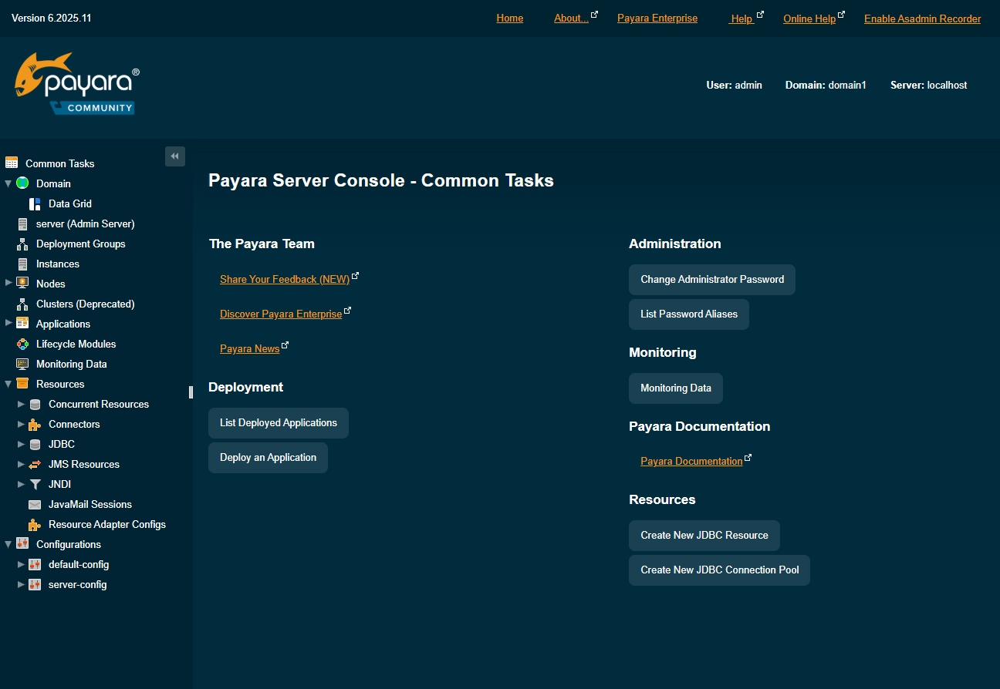
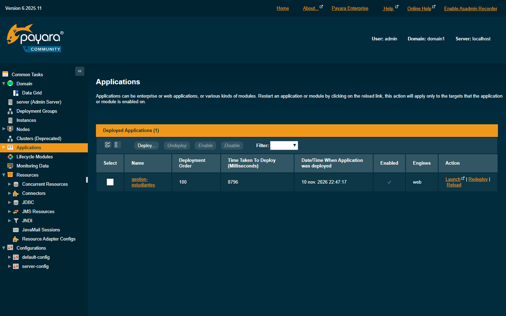
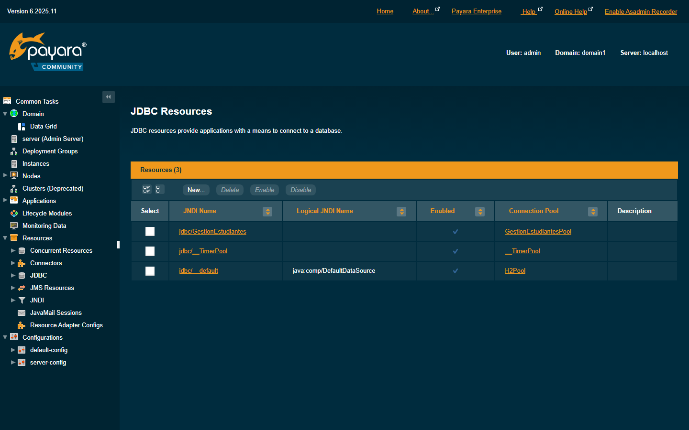
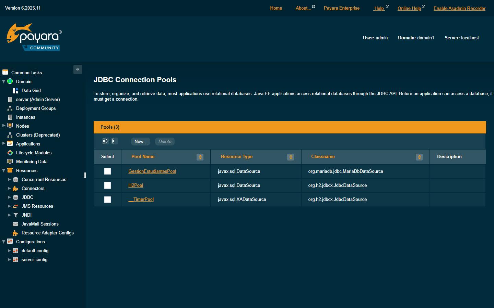

# Evidencias de despliegue en Payara Server

**Proyecto:** Sistema de Gestión de Estudiantes  
**Aplicación:** `gestion-estudiantes`  
**Fecha de captura:** 10 de noviembre de 2026, 22:47 (UTC−05:00)  
**URL:** <http://localhost:8080/gestion-estudiantes/>  
**Consola de Payara:** <http://localhost:4848>

---

## Resumen

El WAR `target/gestion-estudiantes.war` fue compilado con Maven, desplegado en **Payara Server Community 6.2025.11** y verificado contra **MariaDB 10.4.32**. La aplicación responde HTTP 200 con la cabecera `Server: Payara Server 6.2025.11` y el pool JNDI conecta correctamente con la base de datos.

| Componente | Versión / valor |
|---|---|
| Java | Temurin 21.0.13+9 LTS |
| Payara Server | 6.2025.11 (build 43) |
| Dominio | `domain1` |
| Puerto HTTP | 8080 |
| Puerto de administración | 4848 |
| MariaDB | 10.4.32 (XAMPP), puerto 3306 |
| Base de datos | `gestion_estudiantes` |
| Pool JDBC | `GestionEstudiantesPool` |
| Recurso JNDI | `jdbc/GestionEstudiantes` |

---

## 1. Consola de Payara



La consola muestra la versión **6.2025.11**, el dominio **`domain1`**, el servidor **`localhost`** y el usuario **`admin`**.

---

## 2. Aplicación desplegada



En **Applications → Deployed Applications** aparece:

- **`gestion-estudiantes`**
- Tipo **web**
- Estado **Enabled** ✓
- Desplegada el **10 nov. 2026 22:47:17**
- Acciones: Launch, Redeploy, Reload

---

## 3. Recurso JNDI



En **Resources → JDBC → JDBC Resources**:

- JNDI Name: **`jdbc/GestionEstudiantes`**
- Connection Pool: **`GestionEstudiantesPool`**
- Enabled ✓

---

## 4. Pool de conexiones



En **Resources → JDBC → JDBC Connection Pools**:

- Pool: **`GestionEstudiantesPool`**
- Resource Type: **`javax.sql.DataSource`**
- Classname: **`org.mariadb.jdbc.MariaDbDataSource`**

---

## 5. Comandos de verificación

### Versión de Java y Payara

```text
openjdk version "21.0.13" 2026-10-20 LTS
OpenJDK Runtime Environment Temurin-21.0.13+9 (build 21.0.13+9-LTS)
OpenJDK 64-Bit Server VM Temurin-21.0.13+9 (build 21.0.13+9-LTS, mixed mode, sharing)

Version = Payara Server 6.2025.11 (build 43)
Command version executed successfully.
```

### Dominio, aplicación y componente

```text
domain1 running
Command list-domains executed successfully.

gestion-estudiantes  <web>
Command list-applications executed successfully.

Status of gestion-estudiantes is enabled.
Command show-component-status executed successfully.
```

### Pool, JNDI y conexión real

```text
__TimerPool
H2Pool
GestionEstudiantesPool
Command list-jdbc-connection-pools executed successfully.

jdbc/__TimerPool
jdbc/__default
jdbc/GestionEstudiantes
Command list-jdbc-resources executed successfully.

Command ping-connection-pool executed successfully.
```

### Redespliegue del WAR

```text
Application deployed with name gestion-estudiantes.
Command deploy executed successfully.
```

### Respuesta HTTP

```text
HTTP 200
Content-Type: text/html;charset=UTF-8
Server: Payara Server 6.2025.11
X-Powered-By: Servlet/6.0 JSP/3.1 (Payara Server 6.2025.11 Java/Eclipse Adoptium/21)
```

### Puertos en escucha

```text
LocalAddress LocalPort OwningProcess
------------ --------- -------------
::                8080         18740
::                4848         18740
::                3306         21904
```

Los puertos **8080** (HTTP) y **4848** (administración) pertenecen al proceso Java de Payara; **3306** a MariaDB.

### Extracto de `server.log`

```text
gestion-estudiantes was successfully deployed in 3,309 milliseconds.
Running Payara Version: Payara Server 6.2025.11 (build 43)
Payara Server 6.2025.11 (43) startup time : Felix (31586ms), startup services(5762ms), total(37348ms)
Loading application [gestion-estudiantes] at [/gestion-estudiantes]
gestion-estudiantes was successfully deployed in 8,796 milliseconds.
```

---

## 6. Reproducción

```powershell
.\mvnw.cmd clean package
& "C:\payara6\bin\asadmin.bat" start-domain
& "C:\payara6\bin\asadmin.bat" deploy --force .\target\gestion-estudiantes.war
& "C:\payara6\bin\asadmin.bat" list-applications
& "C:\payara6\bin\asadmin.bat" ping-connection-pool GestionEstudiantesPool
```

---

## 7. Nota sobre el puerto 8080

El Tomcat incluido en XAMPP estaba ocupando el puerto 8080 con sus aplicaciones de ejemplo. Se detuvo para liberar el puerto y se inició Payara. Actualmente **8080** y **4848** son atendidos por Payara con JDK 21.

---

## 8. Privacidad

Las capturas del dashboard y del listado de estudiantes contienen datos personales reales, por lo que **no se publican en este repositorio**. Se entregan por separado en el ZIP de evidencias para el profesor.

---

**Fin de las evidencias.**
